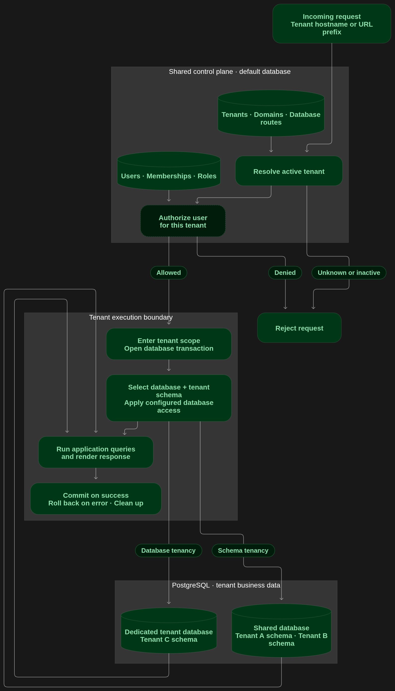
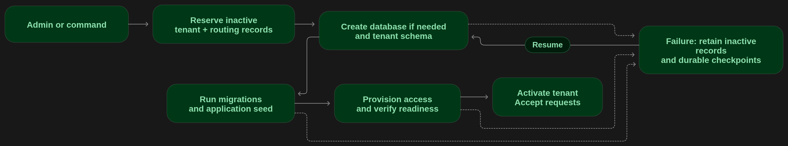

# PartitionDB

Explicit PostgreSQL tenancy for Python, with optional Django and Celery adapters.
Use tenant schemas in a shared database, restricted PostgreSQL roles, or a database
per tenant. Shared identity and lifecycle metadata stay in the control plane.

The core has no runtime dependencies. Python 3.11+ is supported; Django 6.x needs
Python 3.12+. PostgreSQL 16 is the integration target. This is alpha software;
validate your application and deployment before upgrading.

## Try the application

```sh
docker compose up --build -d
```

Open http://localhost:8000/admin/ and sign in with `admin` / `local-admin-only`.
This local stack runs `tests/django_project` with two PostgreSQL servers, OpenBao,
Nginx/Gunicorn, RabbitMQ, Celery, Redis and Mailpit. Credentials are local fixtures.
See [local setup](docs/LOCAL_INFRASTRUCTURE.md) for tenant creation and service access.

## Install from GitHub

Pin the tag you have validated; for example:

```sh
pip install 'partitiondb[django] @ git+https://github.com/forafekt/partitiondb.git@v0.2.0a37'
```

The checkout metadata declares `0.2.0a37` and includes unreleased changes.
These guides describe the working tree; a pinned release may not include every
documented feature. Extras: `postgres`, `django`, `celery`,
`testing`, and `dev`. GitHub installation remains the release path for this project.

## Execution boundaries

```python
from partitiondb import Tenant, current_tenant, tenant_scope

tenant = Tenant("customer-42", "customer_42")
with tenant_scope(tenant):
    assert current_tenant() == tenant
```

`tenant_scope` carries identity; it does not open a database transaction or grant
access. Use `partitiondb.postgres.transaction(connection, tenant)` for psycopg or
`partitiondb.adapters.django.routing.scope.atomic_tenant(tenant)` for Django database work.
Resolve identity from trusted metadata and check membership before entering a scope.

## Usage flow



The managed Django resolver looks up an active tenant from trusted hostname or
subfolder metadata. Authorization runs in shared context before tenant work;
the built-in authorizer checks active membership. Shared users, domains,
memberships, database routes and lifecycle evidence remain on `default`.

`atomic_tenant` resolves the database route and runtime credentials, enters tenant
scope and owns the transaction. The backend selects the tenant schema. Each tenant
has a schema, either in the shared database or a dedicated database. Dedicated
databases require restricted PostgreSQL roles; shared-database tenants can use
shared or restricted roles. Restricted roles provide database-enforced separation;
a shared role can still access other granted schemas through qualified SQL.

The request boundary rolls back exceptions and responses with status 400 or above,
commits successful work, and closes the connection. Complete queries, template
rendering and file reads inside the boundary. See [Django request handling](docs/DJANGO.md#requests-and-orm-boundaries)
and [database access](docs/ACCESS.md).

Celery tenant headers carry a stable tenant ID. Each execution/retry resolves the
current active tenant; the task body opens its own database transaction. A tenant
ID does not grant authorization. See [jobs](docs/CELERY.md).

## Setup flow



Configure shared and tenant apps, trusted database sources, authorization and any
required credential provider, then apply shared migrations. Managed creation
reserves inactive tenant/domain metadata and, when needed, a database route. It
prepares the database, creates the tenant schema, runs tenant migrations and the
application's restartable seed hook, provisions restricted access when selected,
and verifies readiness before activating admission. Ordinary model saves do not
provision infrastructure. Creation is synchronous.

Failure preserves inactive records, resources and durable checkpoints. Inspect and
reconcile ambiguous external effects before resuming; completed stages are not
blindly recreated. An ACTIVE checkpoint is separate from registry admission and
does not perform migration upgrades. See [settings](docs/SETTINGS.md),
[database choices](docs/DATABASES.md), and [provisioning and recovery](docs/OPERATIONS.md).

## Guides

| Need | Guide |
| --- | --- |
| Package layout and framework boundaries | [Architecture](docs/ARCHITECTURE.md) |
| Configure Django and customize components | [Settings](docs/SETTINGS.md) |
| Models, admin, authentication and routing | [Django](docs/DJANGO.md) |
| Schema/database tenancy and server profiles | [Databases](docs/DATABASES.md) |
| Restricted roles and secret providers | [Database access](docs/ACCESS.md) |
| Provisioning, recovery and upgrades | [Operations](docs/OPERATIONS.md) |
| Jobs | [Celery](docs/CELERY.md) |
| Cache, storage, templates and static assets | [Integrations](docs/INTEGRATIONS.md) |
| App subsets and URLconfs by tenant type | [Tenant types](docs/TENANT_TYPES.md) |
| Lifecycle and migration notifications | [Events](docs/EVENTS.md) |
| Run checks and prepare a release | [Testing](docs/TESTING.md) |
| Upgrade the original extracted package | [Migration](docs/MIGRATION.md) |

PartitionDB provides default membership roles and CRUD actions. SSO, server/VM deployment,
credential rotation, session termination, automatic retirement, or distributed
rollback remain application/deployment responsibilities. Its local Compose
deployment demonstrates integration, not production HA.
